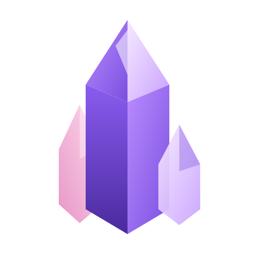
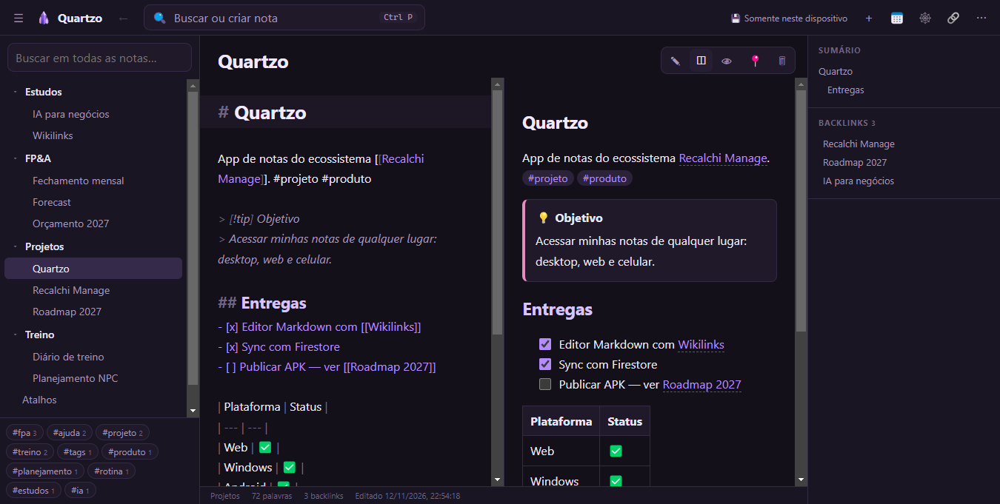
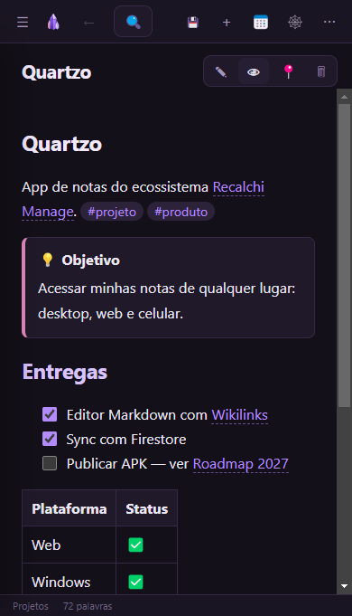

<div align="center">



# Quartzo

**Suas notas conectadas, em qualquer lugar.**

Markdown · links entre notas · grafo · offline · sincronizado com o **Recalchi Manage**


</div>

<p align="center">
  
  &nbsp;
  
</p>

---

## Por que o Quartzo

O Quartzo é um app de notas **local-first** no estilo "segundo cérebro": você escreve em
Markdown, liga ideias com `[[links]]` e enxerga as conexões num grafo. A diferença é que ele
nasce integrado ao ecossistema **Recalchi Manage** — o mesmo login, a mesma base Firebase — e
roda igual no **desktop, no navegador e no celular**, sincronizando em tempo real.

## Recursos

| | |
|---|---|
| ✍️ **Editor Markdown** | CodeMirror 6 com títulos em destaque, busca (Ctrl+F) e autocompletar de `[[links]]` |
| 👁️ **Leitura e lado a lado** | tabelas, callouts `> [!tip]`, tarefas clicáveis, código |
| 🔗 **Conexões** | backlinks, links sem nota (um clique cria), renomear atualiza os links |
| 🕸️ **Grafo** | simulação de forças, zoom, arrastar e abrir notas |
| 🗂️ **Organização** | pastas, #tags com filtro, notas fixadas, lixeira com restauração |
| 📅 **Nota do dia** | diário com modelo de tarefas (Ctrl+D) |
| ⚡ **Busca rápida e comandos** | Ctrl+P para abrir/criar notas, `>` para comandos |
| ☁️ **Sync em tempo real** | Firestore + IndexedDB, funciona offline e resolve conflitos sem perder texto |
| 🔐 **Conta Recalchi Manage** | mesmo e-mail/senha; cada usuário só acessa o próprio vault |
| 📥 **Importar/Exportar** | importa uma pasta de `.md` (inclusive vaults do Obsidian) e exporta `.zip` |
| 🌓 **Temas** | escuro e claro |

## Plataformas

| Plataforma | Como | Saída |
|---|---|---|
| Web / PWA | `npm run build` | `dist/` (instalável pelo navegador) |
| Windows | `npm run desktop:dist` | `release/Quartzo-x.y.z-portable.exe` |
| Android | `npm run android:apk` | `release/Quartzo-x.y.z-debug.apk` |

## Começando

```bash
npm install
cp .env.example .env      # preencha com o firebaseConfig do projeto recalchi-manage
npm run icons             # gera ícones a partir de assets/logo.svg
npm run dev               # http://localhost:5173
```

Sem `.env` o app abre em **modo offline** (notas só no aparelho).

### Ativar a sincronização

1. Cole o bloco de [`docs/firestore.rules.quartzo`](docs/firestore.rules.quartzo) nas regras do
   Recalchi Manage (`firebase/firestore.rules`), antes do bloqueio final.
2. Publique: `npm run rules:deploy` no repositório do Manage.

### Android

Requer JDK 21 e Android SDK (por padrão em `D:\DevTools`, configurável por
`QUARTZO_DEVTOOLS`, `JAVA_HOME`, `ANDROID_HOME`).

```bash
npm run android:apk
```

## Arquitetura

```
src/
  lib/db.ts            IndexedDB (Dexie) — um banco por conta
  lib/sync.ts          motor de sincronização Firestore (tempo real + fila offline + conflitos)
  lib/links.ts         índice de [[links]], backlinks, tags e títulos
  lib/markdown.ts      renderização segura (marked + DOMPurify) com wikilinks e callouts
  lib/firebase.ts      Firebase Auth/Firestore (projeto recalchi-manage)
  components/          Editor, Sidebar, QuickSwitcher, GraphView, Login
electron/main.cjs      shell desktop (protocolo seguro quartzo://)
android/               projeto nativo Capacitor
docs/                  plano de integração e regras do Firestore
```

Dados no Firestore: `manage/modulo/quartzo/{uid}/notes/{noteId}` — seguindo a convenção de
módulos do Recalchi Manage.

## Roadmap

O plano completo (SSO dentro do Manage, notas ligadas a projetos/leads, anexos, IA com Claude,
CI/CD e Play Store) está em [**docs/PLANO_INTEGRACAO.md**](docs/PLANO_INTEGRACAO.md).

## Atalhos

| Ação | Atalho |
|---|---|
| Nova nota | Ctrl/⌘ + N |
| Abrir nota / comandos | Ctrl/⌘ + P |
| Edição ↔ leitura | Ctrl/⌘ + E |
| Nota do dia | Ctrl/⌘ + D |
| Grafo | Ctrl/⌘ + G |
| Painel lateral | Ctrl/⌘ + \ |

## Autor

**Renan Recalchi** — [@recalchi](https://github.com/recalchi)

O Quartzo é um projeto independente e original, sem afiliação com o Obsidian ou a Dynalist Inc.
Licença [MIT](LICENSE).
